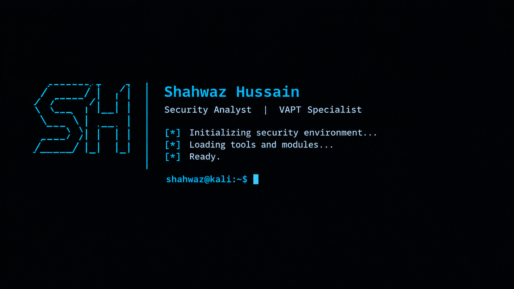

  

<h1 align="center">Shahwaz Hussain</h1>

<h3 align="center">Security Analyst | VAPT | Cybersecurity Consultant</h3>

## Welcome! 👋

Welcome to my cybersecurity portfolio! This repository showcases my knowledge, practical work, and learning journey in Vulnerability Assessment and Penetration Testing (VAPT), application security, and cybersecurity.

My focus is on identifying security weaknesses, understanding their potential impact, validating vulnerabilities, and providing clear remediation recommendations.

## About Me

I am a cybersecurity professional with experience in web application and Android application security testing. My work and learning focus on identifying application-level vulnerabilities, testing business logic, assessing APIs, and preparing professional security assessment reports.

I am continuously improving my technical skills and expanding my knowledge of modern application security practices.

## Technical Skills 🛠️

- **Web Application Security:** Manual security testing, vulnerability validation, business logic testing
- **API Security:** API assessment, request manipulation, authentication and authorization testing
- **Mobile Security:** Android application VAPT
- **Security Methodologies:** OWASP Top 10 security recommendations. Black Box and Gray Box 📦 security assessments.
- **Tools:** Burp Suite, Metasploit, Nmap, Sqlmap, Postman, Nessus Scan, testssl, Wireshark, Kali Linux, VirtualBox Virtualization.
- **Reporting:** Vulnerability documentation, risk assessment, remediation recommendations
- **Other Areas:** HTTP analysis, session management, access control testing

## Certifications 🎓

- NSCE - Net-Square Cybersecurity Expert Programe 

## Professional Experience 💼

### Security Analyst / VAPT Professional

Net-Square Solutions Private Limited

May 2022 - September 2025

Remote, Ahmedabad, India.

- Conducted web application and Android application security assessments.
- Tested applications for common security vulnerabilities and technology-specific weaknesses.
- Assessed business logic and application workflows for security issues.
- Used security testing tools to intercept, inspect, and manipulate HTTP requests.
- Documented findings with evidence, impact, severity, and remediation guidance.
- Prepared professional penetration testing reports for technical and business stakeholders.

## Projects 🔬

### 1. Web Application VAPT

**Objective:** Assess web applications for security vulnerabilities.

- Manual testing of application functionality and workflows.
- Authentication, authorization, and session management testing.
- Input validation and access control assessment.
- Vulnerability impact analysis and remediation guidance.
<!--
[View Project](Projects/Web%20-%20Application%20-%20VAPT/)  -->

### 2. API Security Testing

**Objective:** Evaluate API endpoints and their security controls.

- Authentication and authorization testing.
- Request and parameter manipulation.
- Access control and business logic assessment.
- Security observations and remediation documentation.
<!--
[View Project](Projects/API%20-%20VAPT/)  -->

### 3. Android Application VAPT

**Objective:** Assess Android applications for common mobile security weaknesses.

- Application behavior and data storage review.
- Authentication and session handling assessment.
- Network communication and API interaction testing.
- Security findings and mitigation recommendations.
<!--
[View Project](Projects/Mobile%20-%20Application%20-%20VAPT/) 
-->
<!--
## Sample VAPT Reports 📄

This section will contain sanitized sample reports demonstrating my approach to documenting vulnerabilities, assessing impact, and recommending fixes.

- [Web Application VAPT Report](Sample%20-%20Reports/Web-VAPT-Report.pdf)
- [API Security Assessment Report](Sample%20-%20Reports/API-VAPT-Report.pdf)
- [Mobile Application VAPT Report](Sample%20-%20Reports)   -->

## Training & Learning 📚

- Web application penetration testing
- API security assessment
- Android application security testing
- OWASP testing methodologies
- Vulnerability analysis and professional reporting
<!--
## White Papers & Research 📝

I use this section to document security research, technical write-ups, lessons learned, and practical findings from authorized labs.

- [Security Write-ups](Research/)
- [Testing Notes and Resources](Notes/)
-->

## Education 🎓

- **Qualification:** Bachelor of Technology - Information Technology.
- **Institution:** Jamia Hamdard University, New Delhi, India.
- **Graduation Year:** 2017

## Resume

📄 [View My Resume](Professional%20CV/ShahwazHussain_CV.pdf)

## Seeking Opportunities 🌟

I am interested in opportunities in:

- Vulnerability Assessment and Penetration Testing (VAPT)
- Application Security
- Web and API Security Testing
- Mobile Application Security

I welcome opportunities to learn, collaborate, and contribute to improving the security of applications and digital systems.

## Connect with Me 📧

- **LinkedIn:** https://www.linkedin.com/in/shahran5
- **Email:** shahwaz.hu23@gmail.com

---

  <i>Identify. Validate. Secure.</i>

